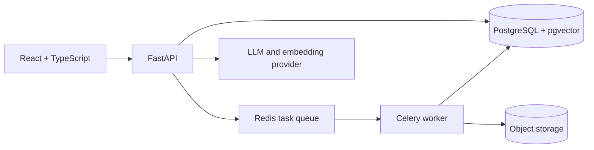

# Atlas architecture

The frontend communicates only with the REST API. The API owns identity, authorization, persistence, retrieval, and prompt assembly. Celery handles extraction and indexing off the request path. PostgreSQL stores application records, chunk metadata, and vectors. Original document bytes use a storage adapter; local development may use a filesystem volume, with S3 intended for deployed environments.

Permission filtering must happen in the retrieval query before context reaches a model. Retrieved text is untrusted data. The model is instructed to ground answers in retrieved context, but authorization and citation validity are enforced in application code. Health is a liveness check; readiness will check database and queue connectivity when dependency lifecycle wiring is implemented.

The vector schema starts with 1536 dimensions. The configured embedding provider must match this dimension, or a migration must change it before indexing. No provider credentials or model choice are committed in this foundation.
