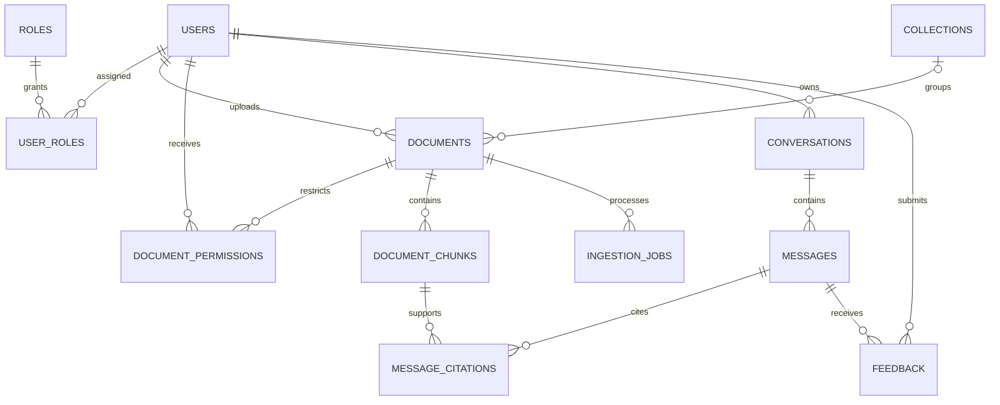

# Atlas initial ER diagram

The initial migration defines these entities and the core ownership foreign keys. Audit events, groups, and shareable collections can be added as authorization requirements are implemented.
